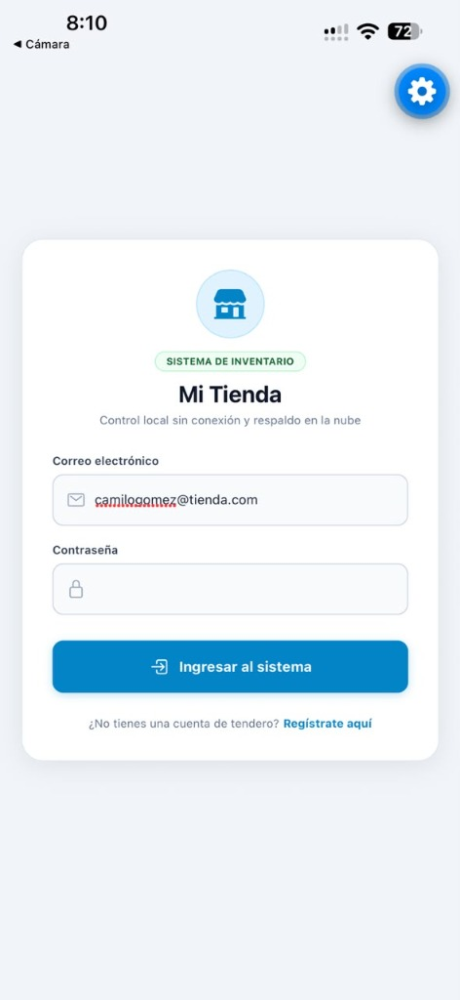
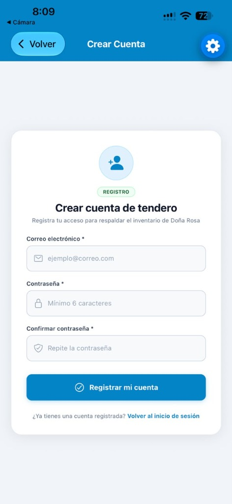
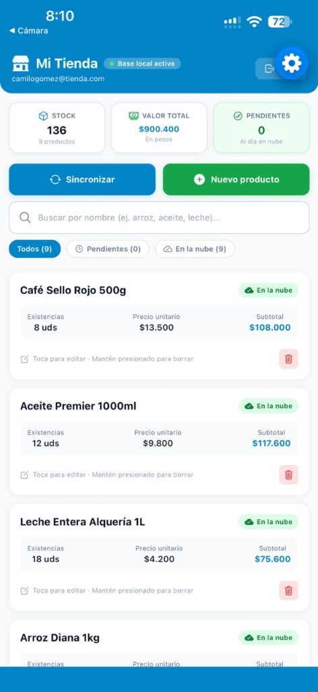
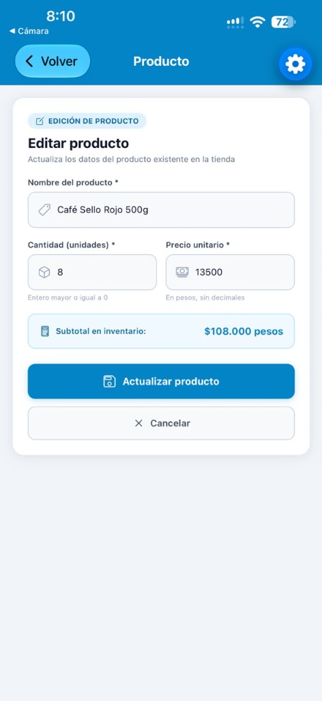
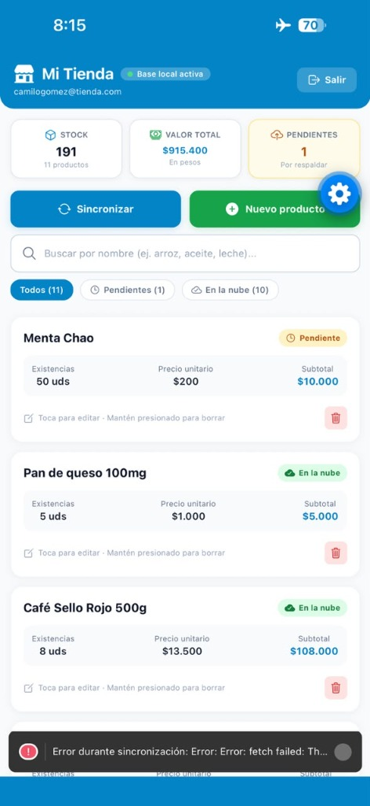
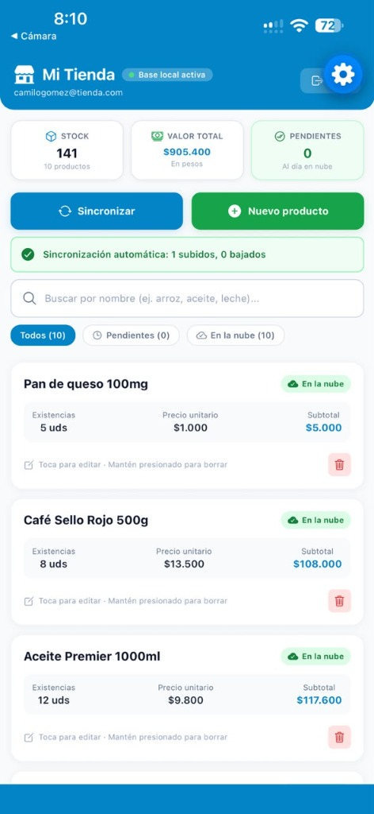
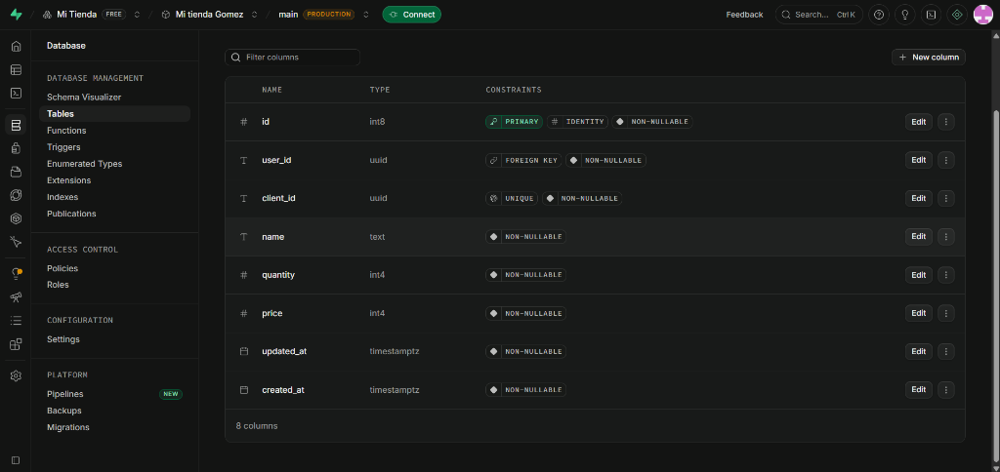

# Parcial: Mi Tienda — App móvil con base de datos local y en la nube

---

## 1. Datos del Estudiante
**Nombre completo:** Camilo Andres Gomez Pimienta  
**Código estudiantil:** 0182220083  

---

## 2. Cómo ejecutar el proyecto

1. **Crear archivo `.env`:**
   Copia el archivo de ejemplo o crea uno nuevo en la raíz con tus claves de Supabase:
   ```bash
   cp .env.example .env
   ```
   Contenido de `.env`:
   ```env
   EXPO_PUBLIC_SUPABASE_URL=https://juogadbxarrjlzvqnhnx.supabase.co
   EXPO_PUBLIC_SUPABASE_PUBLISHABLE_KEY=sb_publishable_fn-9nkUbxengu61g4op2gg_EEj1fjWn
   ```
   *(El archivo `.env` está protegido en `.gitignore` y no se sube a GitHub).*

2. **Ejecutar el SQL en Supabase:**
   En el panel de tu proyecto de Supabase, entra al **SQL Editor** y ejecuta el script de `supabase/schema.sql`:
   ```sql
   create table if not exists public.products (
     id bigint generated always as identity primary key,
     user_id uuid not null default auth.uid() references auth.users (id) on delete cascade,
     client_id uuid not null unique,
     name text not null,
     quantity integer not null check (quantity >= 0),
     price integer not null check (price >= 0),
     updated_at timestamptz not null,
     created_at timestamptz not null default now()
   );

   alter table public.products enable row level security;

   create policy "ver los míos" on public.products
     for select to authenticated using ((select auth.uid()) = user_id);

   create policy "crear los míos" on public.products
     for insert to authenticated with check ((select auth.uid()) = user_id);

   create policy "editar los míos" on public.products
     for update to authenticated
     using ((select auth.uid()) = user_id)
     with check ((select auth.uid()) = user_id);

   create policy "borrar los míos" on public.products
     for delete to authenticated using ((select auth.uid()) = user_id);
   ```
   *Nota:* En *Authentication > Providers > Email*, desactiva la opción **"Confirm email"** para iniciar sesión inmediatamente sin confirmación por correo.

3. **Instalar dependencias:**
   ```bash
   npm install
   ```

4. **Iniciar la aplicación:**
   ```bash
   npx expo start
   ```
   Escanea el código QR con **Expo Go** en tu dispositivo físico o presiona `w` para probar en el navegador web.

---

## 3. Capturas de Pantalla

A continuación se presentan las capturas requeridas en la evaluación tomadas directamente desde la aplicación en ejecución móvil:

### 01. Pantalla de inicio de sesión (`01-login.png`)
Muestra la interfaz de autenticación limpia en español, con iconos vectoriales y formulario de acceso.


### 02. Pantalla de registro de usuario (`02-registro.png`)
Formulario de creación de cuenta de tendero con campos protegidos y validaciones.


### 03. Pantalla principal con productos, totales e indicadores (`03-principal.png`)
Inventario con catálogo de productos, cálculo reactivo de stock total (136 uds), valor total ($900.400 pesos), barra de búsqueda en tiempo real e insignias de sincronización ("En la nube").


### 04. Formulario editando un producto existente (`04-formulario.png`)
Pantalla de edición del producto "Café Sello Rojo 500g" con recálculo dinámico de subtotal ($108.000 pesos) y validación de tipos numéricos.


### 05. Producto creado en modo avión (`05-sin-conexion.png`)
Demostración de funcionamiento sin conexión con producto pendiente de subida.


### 06. Pantalla principal después de sincronizar con resultado (`06-sincronizado.png`)
Muestra la sincronización automática al recuperar la conectividad, con el mensaje descriptivo `"Sincronización automática: 1 subidos, 0 bajados"`, el producto "Pan de queso 100mg" subido a la nube y los totales actualizados (141 uds / $905.400 pesos).


### 07. Panel de Supabase con la tabla products (`07-supabase.png`)
Tabla `products` en la consola de Supabase respaldando las filas sincronizadas.


---

## 4. Qué quedó funcionando y qué no, si algo faltó

### Lo que quedó 100% funcionando:
- **Autenticación (25%):**
  - Registro con validación de correo, longitud de contraseña (mínimo 6 caracteres) y coincidencia.
  - Inicio de sesión y cierre de sesión seguro con Supabase Auth.
  - Persistencia de sesión en `SecureStore` mediante fragmentos (*chunks* de 1000 bytes) que sobrevive al reinicio de la app.
  - Protección de rutas con `Stack.Protected`.
- **Base de datos local (25%):**
  - Esquema SQLite con Drizzle ORM (`id`, `clientId`, `name`, `quantity`, `price`, `updatedAt`, `syncedAt`).
  - Migraciones generadas con `drizzle-kit` y aplicadas con `useMigrations`.
  - Repositorio desacoplado (`db/repositories/products.ts`) y hook reactivo (`useProducts`).
  - CRUD completo (creación, edición, eliminación con confirmación).
  - Cálculo de totales de unidades y valor total del inventario en pesos.
  - Funcionamiento completo en modo avión sin conexión a internet.
  - 4 productos de ejemplo cargados automáticamente.
- **Nube y sincronización (25%):**
  - Políticas de seguridad Row Level Security (RLS) en Supabase para aislamiento por usuario.
  - Sincronización en dos pasos: primero descarga novedades de la nube e inserta las ausentes, luego sube pendientes vía `upsert`.
  - Indicador de estado por producto (`● Pendiente` / `● En la nube`).
  - Mensaje descriptivo con el resultado (`X subidos, Y bajados`).
- **Pantallas y validaciones (10%):**
  - 4 pantallas obligatorias (`login.tsx`, `registro.tsx`, `index.tsx`, `producto.tsx`).
  - Validación de campos obligatorios, enteros mayores o iguales a 0 en precio y cantidad.
  - Confirmación de seguridad antes de eliminar productos.
- **Puntos Extra Implementados (+0.5):**
  - Búsqueda en tiempo real por nombre de producto en la pantalla principal.
  - Regla de conflicto "gana el último cambio" (`cloudUpdatedAt >= local.updatedAt`).
  - Sincronización automática al recuperar la conexión (`useAutoSync`).
  - Borrado seguro y sincronizable.
- **Compatibilidad e Interfaz:**
  - Cero emojis en la interfaz (reemplazados por símbolos limpios como `[⟳]`, `[+]`, `●`, `[X]`).
  - Interfaz 100% en español.
  - Compatibilidad multiplataforma garantizada (Android, iOS y Web).

### ¿Qué faltó?:
- Todo lo exigido en la guía y los criterios de evaluación fue implementado y probado sin componentes faltantes.
